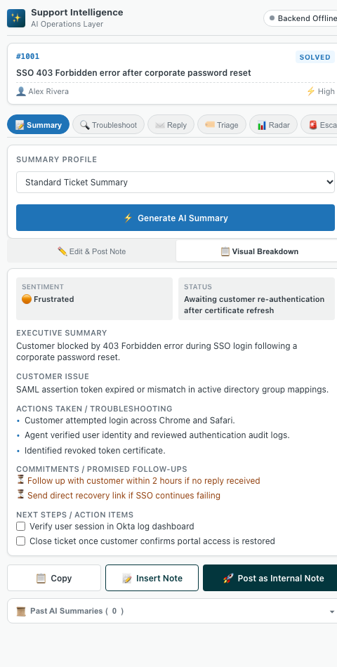
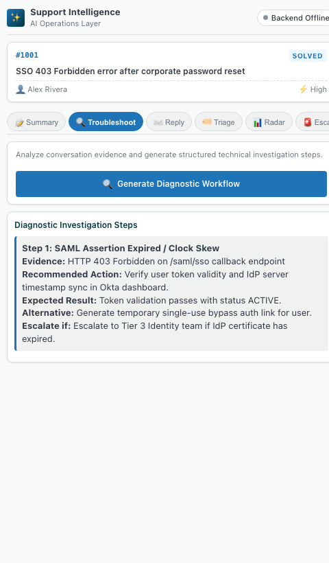
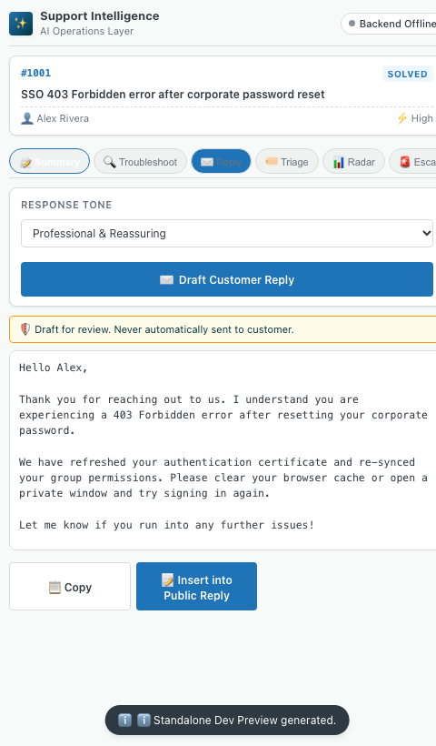
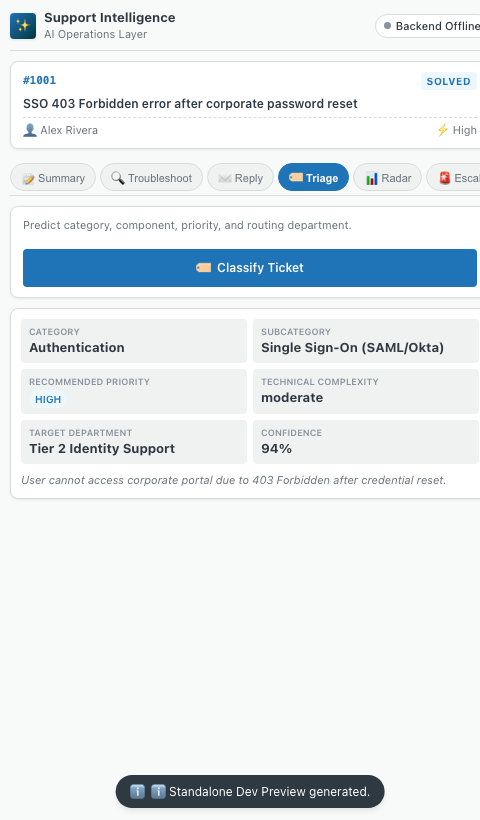
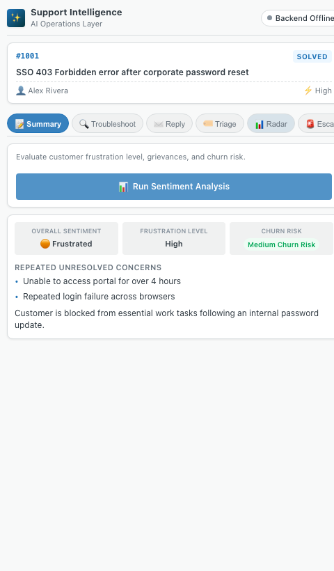
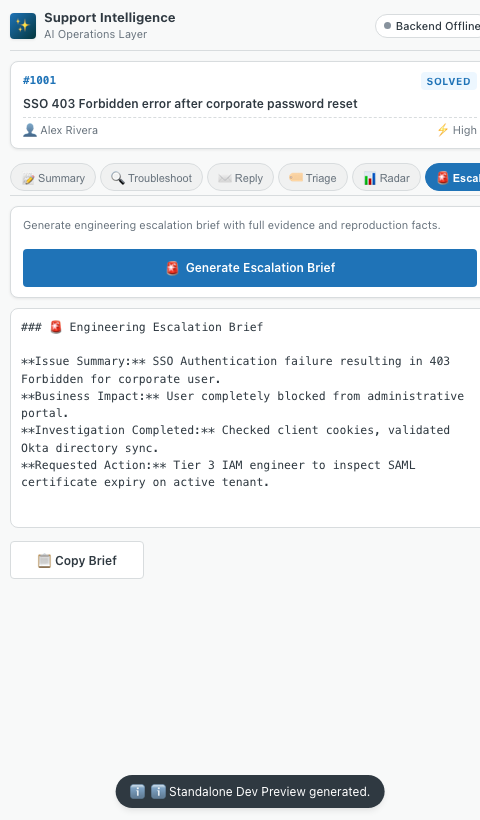
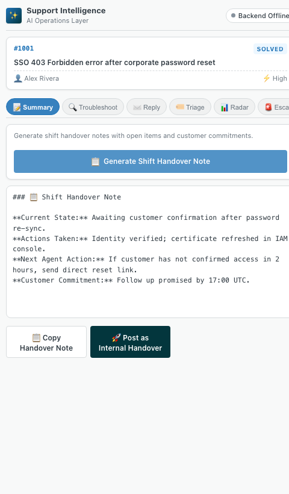
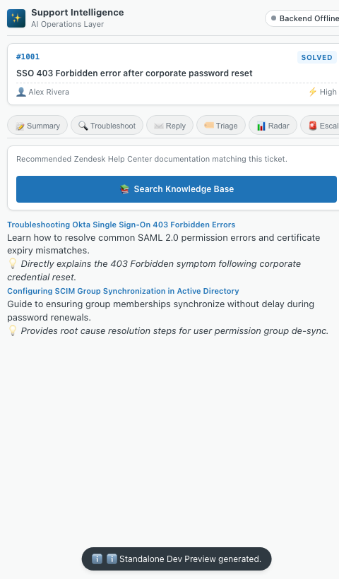
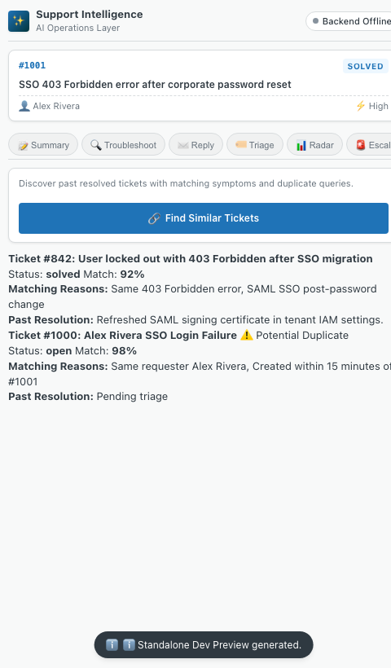

# 🤖 Zendesk Support Intelligence Platform

[](https://www.python.org/)
[](https://fastapi.tiangolo.com/)
[](https://developer.zendesk.com/)
[](https://www.postgresql.org/)
[](https://ai.google.dev/)
[](https://groq.com/)
[](https://platform.openai.com/)
[](https://modelcontextprotocol.io/)
[](https://www.docker.com/)
[-brightgreen?style=for-the-badge&logo=pytest&logoColor=white)](https://pytest.org/)
[](LICENSE)

An enterprise-grade, production-ready **AI Support Intelligence Platform** that transforms customer support operations inside Zendesk. Native Zendesk Agent Workspace integration powered by an asynchronous multi-provider AI orchestration engine, persistent multi-tenant PostgreSQL storage, Celery background workers, and Model Context Protocol (MCP) tool exposure for desktop AI agents.

---

## 📸 Application Previews & Screenshots

### 1. AI Ticket Summarization & Diagnostic Troubleshooting
| AI Summary & Visual Breakdown | Diagnostic Troubleshooting Workflow |
| :---: | :---: |
|  |  |
| *Structured Executive Summary, Commitments & Action Items* | *Diagnostic Procedures, Expected Results & Escalation Thresholds* |

### 2. Context-Grounded Reply Drafting & Ticket Triage
| AI Customer Reply Drafting | Ticket Classification & Triage |
| :---: | :---: |
|  |  |
| *Multi-tone draft generation with human review safeguards* | *Category, component, complexity, and priority recommendations* |

### 3. Customer Sentiment Radar & Escalation Intelligence
| Customer Sentiment & Frustration Radar | Engineering Escalation Brief |
| :---: | :---: |
|  |  |
| *Frustration level, repeated grievances, and churn risk detection* | *Technical evidence, repro details, and requested engineering actions* |

### 4. Shift Handover Intelligence & Knowledge Discovery
| Shift Handover Briefing Note | Help Center Knowledge Base Search |
| :---: | :---: |
|  |  |
| *Status tracking, unresolved blockers, and next-agent obligations* | *Connected Help Center article search & relevance explanations* |

### 5. Historical Similar & Duplicate Ticket Discovery
<p align="center">
  
  <br />
  <em>Historical resolved tickets matching symptoms, similarity confidence scores & duplicate detection</em>
</p>

---

## 📌 Platform Capabilities & Feature Matrix

### 1. Advanced Ticket Summarization Engine (10 Profiles)
* **Standard Ticket Summary**: Balanced overview covering core customer issues, actions taken, commitments, and status.
* **Technical Troubleshooting Summary**: Isolates error codes, reproduction symptoms, log traces, and attempted fixes.
* **Customer Complaint & De-escalation Summary**: Extracts customer grievances, tone escalation triggers, and remediation.
* **Shift Handover Briefing**: High-density notes detailing resolved items, open blockers, customer commitments, and next-agent ownership.
* **Engineering Escalation Summary**: Structured brief with technical evidence and reproduction data for Tier 3/SRE.
* **Software Bug Investigation**: Detailed defect report with version tags, environment details, and expected vs actual behavior.
* **Billing & Payment Dispute**: Invoice numbers, transaction IDs, charge amounts, and dispute timelines.
* **Integration / Webhook Failure**: API endpoints, payload samples, HTTP response codes, and network symptoms.
* **Customer Success Health**: Product adoption sentiment, unresolved friction points, and churn signals.
* **Executive Management Brief**: High-level impact summary without technical jargon.

### 2. Specialized Support Intelligence Subsystems
* 🔍 **AI Troubleshooting Assistant**: Diagnoses issues from conversation evidence, offering structured investigation steps, expected results, alternatives, and escalation thresholds.
* ✉️ **AI Reply Drafting**: Generates context-grounded response drafts across 5 tones (`professional`, `friendly`, `technical`, `empathetic`, `concise`) with human review safeguards.
* 🏷️ **Ticket Classification & Triage**: Predicts issue category, subcategory, product, complexity, department, and priority with confidence scores.
* 📊 **Customer Sentiment & Frustration Radar**: Estimates customer frustration level, grievances, and churn risk.
* 🚨 **Engineering Escalation Briefs**: Rapidly produces escalation summaries containing logs, timestamps, and requested engineering assistance.
* 📋 **Shift Handover Intelligence**: Generates notes that clarify what happened, what was investigated, what is resolved, what remains open, and who owns the next action.
* 📚 **Knowledge Base Recommendations**: Searches Zendesk Help Center documentation and returns articles with relevance explanations.
* 🔗 **Similar & Duplicate Ticket Discovery**: Matches historical resolved tickets sharing error symptoms and detects duplicate requests.

### 3. Enterprise Multi-Provider AI Orchestration
* **Independent Providers**: Native async clients for Google Gemini (1.5 Flash/Pro, 2.0 Flash), OpenAI (GPT-4o, GPT-4o-mini), Anthropic Claude (3.5 Sonnet, 3.5 Haiku), and Groq Cloud (LLaMA 3.3 70B, LLaMA 3.1 8B).
* **Automatic Failover**: Transparent fallback chaining when providers hit rate limits or downtime.
* **Token Budgeting & Cost Tracking**: Calculates USD expenditure per generation based on official token pricing matrices.

### 4. Intelligent Context & Prompt Injection Defense
* **Untrusted Content Isolation**: All customer messages and comments are quarantined inside strict `<<<UNTRUSTED_CONTENT>>>` boundary markers.
* **HTML Cleaning & Entity Decoding**: Converts messy rich-text formatting to clean plain text while stripping unsafe HTML tags.
* **Automated Noise Removal**: Prunes automated email signatures, confidentiality disclaimers, and quoted previous replies.
* **Automated PII Redaction**: Scrubs credit card numbers, Social Security Numbers, and API secrets/passwords before LLM dispatch.

### 5. Multi-Tenant Persistence & DevOps
* **PostgreSQL 16 & Async SQLAlchemy 2.x**: Tenant-isolated tables with indexed `organization_id` partitions.
* **Alembic Migrations**: Fully automated migration pipeline (`alembic upgrade head`).
* **Celery & Redis Worker Fleet**: Asynchronously processes solve webhooks in the background.
* **JWT & RBAC**: Role-based access control (`super_admin`, `org_admin`, `manager`, `support_agent`, `analyst`).
* **Containerized Stack**: Production-ready multi-stage `Dockerfile` and `docker-compose.yml`.

### 6. Model Context Protocol (MCP) Integration
* Exposes **13 standardized MCP tools** via FastMCP over standard I/O (stdio).
* Connects seamlessly with Claude Desktop, Cursor, Google Antigravity, and Gemini CLI.

---

## 🏛️ System Architecture

```
┌─────────────────────────────────────────────────────────────────────────────┐
│                       Zendesk Agent Workspace                               │
│                                                                             │
│  ┌───────────────────────────────────────────────────────────────────────┐  │
│  │      zendesk-app/ (ZAF v2 9-Tab Intelligence Sidebar Extension)        │  │
│  └───────────────────────────────────┬───────────────────────────────────┘  │
└──────────────────────────────────────┼──────────────────────────────────────┘
                                       │ HTTPS / JSON + JWT
                                       ▼
┌─────────────────────────────────────────────────────────────────────────────┐
│                    FastAPI REST API Gateway (backend/)                      │
│                                                                             │
│  • Sliding-Window Rate Limiter (IP/User)                                    │
│  • HMAC-SHA256 Webhook Verification with 300s Timestamp Skew Defense        │
│  • JWT Authentication & Role-Based Access Control (RBAC)                    │
│  • Analytics & Streaming CSV Export                                         │
└───────────────────────────────────┬─────────────────────────────────────────┘
                                    │
                     Coordinates via│Service Layer
                                    ▼
┌─────────────────────────────────────────────────────────────────────────────┐
│                     Shared Core (shared/ - Domain Layer)                    │
│                                                                             │
│  ┌───────────────────────────────────┐   ┌───────────────────────────────┐  │
│  │   Intelligent Context Engine      │   │   Multi-Provider Orchestrator │  │
│  │   • PII Redaction                 │   │   • Fallback Chain            │  │
│  │   • HTML / Signature Stripping    │   │   • Token Cost Calculation    │  │
│  │   • Prompt Injection Delimiters   │   │   • Exponential Backoff       │  │
│  └───────────────────────────────────┘   └───────────────┬───────────────┘  │
└───────────────────────────────────┬──────────────────────┼──────────────────┘
                                    │                      │
             Stores Tenant Data &   │                      │ AI Generation
             Audit Trails           ▼                      ▼
┌───────────────────────────────────────┐  ┌──────────────────────────────────┐
│   PostgreSQL 16 & Redis 7 Subsystem   │  │ External AI Provider Endpoints   │
│   • Persistent Multi-Tenant Schema    │  │ • Google Gemini (Flash / Pro)    │
│   • Celery Asynchronous Worker Fleet  │  │ • Groq Cloud (LLaMA 3.3 70B)     │
│   • Webhook Idempotency Registry      │  │ • OpenAI (GPT-4o / GPT-4o-mini)  │
│   • Usage Economics Ledger            │  │ • Anthropic Claude (3.5 Sonnet)  │
└───────────────────────────────────────┘  └──────────────────────────────────┘
```

---

## ⚡ Quickstart Guide

### 1. Clone & Set Up Local Virtual Environment
```bash
git clone https://github.com/SadeeshaJayaweera/Zendesk-Ticket-Summarization-Extension.git
cd Zendesk-Ticket-Summarization-Extension

python3.11 -m venv .venv
source .venv/bin/activate
pip install --upgrade pip poetry-core wheel
pip install -e ./shared -e ./backend -e ./mcp-server --no-deps
pip install fastapi uvicorn[standard] pydantic pydantic-settings python-dotenv httpx sqlalchemy[asyncio] alembic asyncpg aiosqlite greenlet pyjwt bcrypt redis celery mcp respx pytest pytest-asyncio pytest-cov
```

### 2. Configure Environment Variables
```bash
cp .env.example .env
# Edit .env with your Zendesk subdomain, API token, and AI provider key(s)
```

### 3. Apply Database Migrations
```bash
alembic upgrade head
```

### 4. Launch the Docker Compose Production Stack
```bash
docker compose up -d
```
* **REST API & Swagger Docs**: `http://localhost:8000/docs`
* **Health Check**: `http://localhost:8000/health`
* **Prometheus Metrics**: `http://localhost:8000/metrics`

---

## 🧪 Comprehensive Verification & Test Suite

The platform includes **123 automated tests** covering unit logic, integration endpoints, security protections, and MCP tools with ~81% overall code coverage.

```bash
# Run the entire test suite
./.venv/bin/pytest backend/ shared/ mcp-server/

# Run with coverage report
./.venv/bin/pytest --cov=shared --cov=backend --cov=mcp_server backend/ shared/ mcp-server/
```

---

## 📦 Packaging & Deploying the Zendesk App

Package the sidebar extension for Zendesk Agent Workspace:
```bash
cd zendesk-app
python3 package_app.py
```
The validated package `dist/zendesk-ticket-summarizer.zip` is ready for direct upload in **Zendesk Admin Center > Apps and integrations > Zendesk Support apps > Upload private app**.

---

## 📚 Complete Documentation Suite

Detailed guides are available in the [`docs/`](docs) directory:

1. [System Architecture](docs/SYSTEM_ARCHITECTURE.md)
2. [Database Schema & ER Diagrams](docs/DATABASE_SCHEMA.md)
3. [REST API Documentation](docs/API_DOCUMENTATION.md)
4. [Security & DevSecOps](docs/SECURITY.md)
5. [Privacy & Data Retention](docs/PRIVACY_AND_DATA_RETENTION.md)
6. [Local Development Setup](docs/DEVELOPMENT_SETUP.md)
7. [Environment Variables Dictionary](docs/ENVIRONMENT_VARIABLES.md)
8. [Zendesk Installation & Webhooks](docs/ZENDESK_INSTALLATION.md)
9. [AI Provider Setup & Fallback Chains](docs/AI_PROVIDER_SETUP.md)
10. [Model Context Protocol (MCP) Setup](docs/MCP_SETUP.md)
11. [Production Deployment Guide](docs/DEPLOYMENT.md)
12. [Testing & Verification Guide](docs/TESTING_GUIDE.md)
13. [Troubleshooting & Operational Runbook](docs/TROUBLESHOOTING.md)
14. [Changelog](docs/CHANGELOG.md)

---

## 📄 License

This project is licensed under the MIT License — see the [LICENSE](LICENSE) file for details.
