# Database Schema Documentation: Zendesk Support Intelligence Platform

## 1. Overview

The platform uses **SQLAlchemy 2.x async declarative models** and **Alembic** migrations. It supports both **PostgreSQL 16** (production engine via `asyncpg`) and **SQLite** (development and testing engine via `aiosqlite`).

Every primary table is partitioned by an indexed `organization_id` foreign key to ensure strict multi-tenant isolation.

---

## 2. Entity Relationship Diagram

```mermaid
erDiagram
    ORGANIZATIONS ||--o{ USERS : "contains"
    ORGANIZATIONS ||--o{ SUMMARY_TEMPLATES : "configures"
    ORGANIZATIONS ||--o{ TICKET_REFERENCES : "tracks"
    ORGANIZATIONS ||--o{ SUMMARY_RECORDS : "generates"
    ORGANIZATIONS ||--o{ PENDING_DRAFTS : "stages"
    ORGANIZATIONS ||--o{ WEBHOOK_EVENTS : "receives"
    ORGANIZATIONS ||--o{ USAGE_RECORDS : "bills"
    USERS ||--o{ SUMMARY_RECORDS : "initiates"

    ORGANIZATIONS {
        string id PK "UUID"
        string name "Tenant name"
        string slug UK "Unique URL slug"
        string zendesk_subdomain UK "Zendesk subdomain"
        string zendesk_email "API user email"
        text zendesk_api_token_encrypted "AES-256 token"
        text webhook_secret_encrypted "AES-256 secret"
        string primary_ai_provider "Default: gemini"
        string primary_model "Default: gemini-1.5-flash"
        string fallback_ai_provider "Default: groq"
        string fallback_model "Default: llama-3.3-70b-versatile"
        string default_summary_style "Default: standard"
        boolean allow_internal_notes_to_ai "Default: true"
        boolean allow_attachments_to_ai "Default: false"
        int data_retention_days "Default: 90"
        boolean is_active "Default: true"
        datetime created_at
        datetime updated_at
    }

    USERS {
        string id PK "UUID"
        string organization_id FK "References organizations.id"
        string email "User email address"
        string full_name "Full name"
        string hashed_password "Bcrypt hashed password"
        string role "super_admin, org_admin, manager, support_agent"
        boolean is_active "Default: true"
        datetime created_at
        datetime updated_at
    }

    SUMMARY_TEMPLATES {
        string id PK "UUID"
        string organization_id FK "References organizations.id"
        string name "Template label"
        string style_key "e.g. technical, handover"
        string description "Template description"
        text custom_system_prompt "System prompt override"
        text guidance_instructions "Specific terminology rules"
        boolean is_default "Default: false"
        datetime created_at
        datetime updated_at
    }

    TICKET_REFERENCES {
        string id PK "UUID"
        string organization_id FK "References organizations.id"
        int zendesk_ticket_id "Zendesk ID"
        string subject "Ticket subject"
        string status "open, solved, closed"
        string priority "low, normal, high, urgent"
        string category "Predicted classification"
        string detected_sentiment "positive, neutral, frustrated"
        string requester_name
        string assignee_name
        datetime created_at
        datetime updated_at
    }

    SUMMARY_RECORDS {
        string id PK "UUID"
        string organization_id FK "References organizations.id"
        int ticket_id "Zendesk Ticket ID"
        string user_id FK "References users.id"
        string style "standard, technical, handover, etc."
        string provider_used "gemini, groq, openai, anthropic"
        string model_used "Model identifier"
        text executive_summary "1-2 sentence core"
        text customer_issue "Issue definition"
        json structured_json "Full structured JSON payload"
        text markdown_content "Formatted internal note"
        int prompt_tokens "Input tokens"
        int completion_tokens "Output tokens"
        float estimated_cost_usd "Estimated cost"
        float latency_seconds "Generation duration"
        boolean was_posted_to_zendesk "Posted status"
        string source "agent_request, webhook_solve"
        datetime created_at
    }

    PENDING_DRAFTS {
        string id PK "UUID"
        string organization_id FK "References organizations.id"
        int ticket_id "Zendesk Ticket ID"
        string status "pending_review, posted, dismissed"
        string summary_style "standard, technical, etc."
        json structured_data "Extracted summary JSON"
        text markdown_note "Draft markdown note"
        string source_trigger "zendesk_webhook_solved"
        datetime created_at
        datetime updated_at
    }

    WEBHOOK_EVENTS {
        string id PK "UUID"
        string organization_id FK "References organizations.id"
        string event_id UK "Unique Zendesk Event ID"
        string event_type "ticket_status_changed"
        int ticket_id "Target ticket ID"
        string status "received, processing, completed, failed"
        json payload "Raw webhook JSON payload"
        text error_message "Error trace if failed"
        datetime processed_at "Timestamp completed"
        datetime created_at
    }

    AUDIT_LOGS {
        string id PK "UUID"
        string organization_id "Tenant ID"
        string user_id "Actor user ID"
        int ticket_id "Related ticket ID"
        string event_type "summarize, post_note, webhook"
        string action "Specific operation"
        string status "success, failure"
        string ip_address "Client IP"
        string model_used "AI model used"
        json details "Detailed context"
        datetime created_at
    }

    USAGE_RECORDS {
        string id PK "UUID"
        string organization_id FK "References organizations.id"
        string user_id "User identifier"
        string provider "gemini, groq, openai, anthropic"
        string model "Model identifier"
        string operation "summarize, troubleshoot, reply"
        int prompt_tokens "Prompt tokens"
        int completion_tokens "Completion tokens"
        int total_tokens "Total tokens"
        float estimated_cost_usd "Calculated expenditure"
        datetime created_at
    }
```



---

## 3. Database Indexes

| Table | Index Name | Columns | Type | Purpose |
| :--- | :--- | :--- | :--- | :--- |
| `organizations` | `ix_organizations_slug` | `slug` | Unique B-Tree | Fast lookup for tenant routing |
| `organizations` | `ix_organizations_zendesk_subdomain` | `zendesk_subdomain` | Unique B-Tree | Tenant lookup on inbound webhooks |
| `users` | `idx_user_org_email` | `organization_id, email` | Unique Composite | Enforces unique email per organization |
| `ticket_references` | `idx_ticket_org_tid` | `organization_id, zendesk_ticket_id` | Unique Composite | Fast ticket metadata caching per tenant |
| `pending_drafts` | `idx_draft_org_ticket` | `organization_id, ticket_id` | Composite B-Tree | Fast retrieval of staged pending review drafts |
| `webhook_events` | `ix_webhook_events_event_id` | `event_id` | Unique B-Tree | Webhook idempotency & replay deduplication |
| `summary_records` | `ix_summary_records_ticket_id` | `ticket_id` | B-Tree | Fast ticket summary history lookups |
| `summary_records` | `ix_summary_records_created_at` | `created_at` | B-Tree | Time-range filtering for analytics dashboards |
| `usage_records` | `ix_usage_records_organization_id` | `organization_id` | B-Tree | Aggregating tenant token economics and bills |

---

## 4. Alembic Migration Commands

```bash
# Apply all pending migrations to head
alembic upgrade head

# Roll back the most recent migration
alembic downgrade -1

# Generate a new migration revision based on model changes
alembic revision --autogenerate -m "Add custom instructions field"

# View migration history
alembic history --verbose
```
