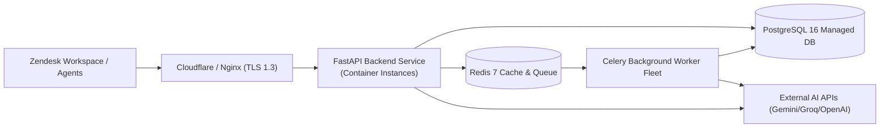

# Production Deployment Guide

This guide covers production deployment architectures for the **Zendesk Support Intelligence Platform**, spanning containerized Docker Compose stacks, Cloud Run / Kubernetes deployments, secrets management, and zero-downtime rolling updates.

---

## 1. Hosting Architecture Overview



---

## 2. Docker Compose Deployment (Single-Node Host / VPS)

For single-instance production servers (e.g. AWS EC2, DigitalOcean Droplet, Hetzner Cloud):

### Step 1: Clone & Configure
```bash
git clone https://github.com/SadeeshaJayaweera/Zendesk-Ticket-Summarization-Extension.git /opt/zendesk-platform
cd /opt/zendesk-platform
cp .env.example .env
chmod 600 .env
nano .env  # Enter production credentials
```

### Step 2: Launch Production Stack
```bash
docker compose up -d --build
```

### Step 3: Verify Container Health
```bash
docker compose ps
docker compose logs -f backend
```

---

## 3. Google Cloud Run Deployment

Google Cloud Run offers a fully-managed serverless environment with automatic scaling:

### Step 1: Build & Push Container to Artifact Registry
```bash
gcloud builds submit --tag gcr.io/PROJECT_ID/zendesk-intelligence-backend:latest
```

### Step 2: Deploy Cloud Run Service
```bash
gcloud run deploy zendesk-intelligence-api \
  --image gcr.io/PROJECT_ID/zendesk-intelligence-backend:latest \
  --platform managed \
  --region us-central1 \
  --allow-unauthenticated \
  --set-env-vars "LLM_PROVIDER=gemini,GEMINI_MODEL=gemini-1.5-flash" \
  --set-secrets "ZENDESK_API_TOKEN=zendesk-token:latest,GEMINI_API_KEY=gemini-key:latest,DATABASE_URL=db-url:latest" \
  --min-instances 1 \
  --max-instances 10 \
  --cpu 2 \
  --memory 2Gi \
  --port 8000
```

---

## 4. Kubernetes Manifest Deployment

```yaml
apiVersion: apps/v1
kind: Deployment
metadata:
  name: zendesk-intelligence-api
  labels:
    app: zendesk-intelligence
spec:
  replicas: 3
  selector:
    matchLabels:
      app: zendesk-intelligence
  template:
    metadata:
      labels:
        app: zendesk-intelligence
    spec:
      containers:
      - name: api
        image: your-registry/zendesk-intelligence:v1.0.0
        ports:
        - containerPort: 8000
        envFrom:
        - secretRef:
            name: zendesk-platform-secrets
        resources:
          requests:
            cpu: "250m"
            memory: "512Mi"
          limits:
            cpu: "1000m"
            memory: "1Gi"
        livenessProbe:
          httpGet:
            path: /health
            port: 8000
          initialDelaySeconds: 15
          periodSeconds: 20
        readinessProbe:
          httpGet:
            path: /health
            port: 8000
          initialDelaySeconds: 5
          periodSeconds: 10
```

---

## 5. Pre-Flight Production Checklist

* [ ] Set non-default `JWT_SECRET_KEY` in environment variables.
* [ ] Enforce HTTPS (TLS 1.3) on all external domain endpoints.
* [ ] Verify PostgreSQL database backups and WAL archiving are active.
* [ ] Configure sliding-window rate limit (`RATE_LIMIT_PER_MINUTE=120`).
* [ ] Enable PII redaction (`ENABLE_PII_REDACTION=true`).
* [ ] Test Zendesk webhook signature verification with `ZENDESK_WEBHOOK_SECRET`.
* [ ] Verify monitoring metrics endpoint (`/metrics`) is scraped by Prometheus.
