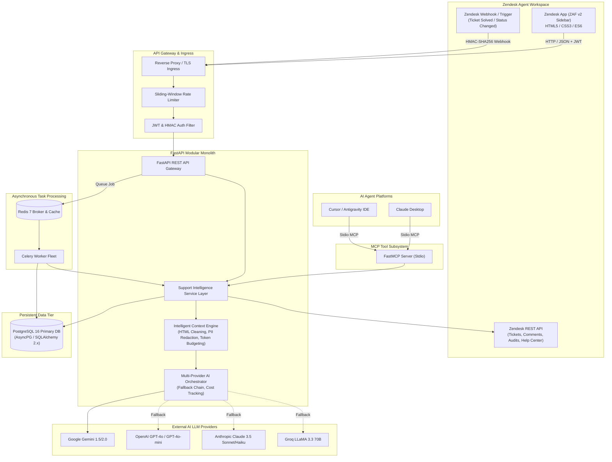

# System Architecture: Zendesk Support Intelligence Platform

## 1. Executive Summary

The **Zendesk Support Intelligence Platform** is an enterprise-grade AI operations and conversation intelligence layer designed for modern customer experience and technical support organizations. Built on a modular monolith foundation with independent asynchronous workers, it provides native Zendesk Agent Workspace integration, multi-provider AI orchestration with automatic failover, durable webhook processing, and Model Context Protocol (MCP) tool exposure for desktop AI agents.

---

## 2. Architectural Principles

1. **Human-in-the-Loop Safety**: AI outputs (summaries, replies, triage suggestions) are presented as editable drafts. The platform strictly enforces that no customer-facing replies are published without explicit human agent confirmation.
2. **Untrusted Input Quarantine (Prompt Injection Defense)**: All customer conversation text, email signatures, and HTML bodies are quarantined inside strict isolation delimiters (`<<<UNTRUSTED_CONTENT>>>`) to prevent prompt injection and unauthorized instruction execution.
3. **Multi-Tenant Isolation**: Every database entity is partitioned with an indexed `organization_id` foreign key, ensuring rigorous logical data segregation across tenants.
4. **Provider-Agnostic AI Orchestration**: Generation requests flow through an abstract AI Orchestrator supporting Google Gemini, OpenAI, Anthropic Claude, and Groq with automatic fallback, token budgeting, and cost telemetry.
5. **Durable Webhook Processing**: Inbound webhooks from Zendesk are validated using HMAC-SHA256 signatures with timestamp skew protection against replay attacks, stored in persistent storage, and processed asynchronously.

---

## 3. High-Level Architecture Diagram

---

## 4. Module Boundaries & Responsibilities

### A. Frontend Application (`zendesk-app/`)
* **Technology**: Zendesk Apps Framework (ZAF v2), vanilla ES6, semantic HTML5, Zendesk Garden CSS.
* **Responsibilities**:
  * Displays active ticket metadata in real-time.
  * Provides a 9-tab operations dashboard (`Summary`, `Troubleshoot`, `Reply`, `Triage`, `Radar`, `Escalation`, `Handover`, `Knowledge`, `Similar`).
  * Enables in-place Markdown editing of generated summaries.
  * Executes single-click composer insertion into Zendesk Internal Note or Public Reply.
  * Guards direct posting actions behind a confirmation modal.

### B. REST API Gateway (`backend/app/main.py`)
* **Technology**: FastAPI, Uvicorn, Pydantic v2.
* **Responsibilities**:
  * Provides validated REST endpoints for ticket intelligence operations.
  * Enforces IP and token rate limits using an in-memory sliding window algorithm.
  * Validates HMAC-SHA256 signatures and timestamp freshness on Zendesk webhook payloads.
  * Exposes user authentication (registration, login, RBAC) and analytics metrics.
  * Serves health checks and Prometheus-compatible metrics.

### C. Intelligence Service Layer (`shared/zendesk_summarizer_shared/service.py`)
* **Technology**: Python 3.11 asynchronous service layer.
* **Responsibilities**:
  * Coordinates ticket fetching, user mapping, and comment pagination via `ZendeskClient`.
  * Invokes `IntelligentContextEngine` for text cleaning, PII redaction, and prompt injection quarantine.
  * Dispatches structured generation tasks to `AIOrchestrator`.
  * Manages pending drafts and saves summary history.

### D. AI Orchestration Engine (`shared/zendesk_summarizer_shared/ai/`)
* **Technology**: Native async `httpx` clients for Google Gemini, OpenAI, Claude, and Groq.
* **Responsibilities**:
  * Evaluates configurable fallback chains (e.g. Gemini 1.5 Flash -> Groq LLaMA 3.3 70B -> OpenAI GPT-4o-mini).
  * Automatically retries with exponential backoff on transient network and rate-limit errors.
  * Extracts, parses, and validates structured JSON outputs against strict Pydantic schemas.
  * Accurately tracks token usage and calculates USD generation expenditures.

### E. Database & Persistence Layer (`shared/zendesk_summarizer_shared/db/`)
* **Technology**: SQLAlchemy 2.0 (Async), Alembic, PostgreSQL 16 (`asyncpg`), SQLite (`aiosqlite`).
* **Responsibilities**:
  * Stores multi-tenant organizations, users, and roles.
  * Persists historical summary records, pending review drafts, and audit logs.
  * Records webhook events for idempotency and replay protection.
  * Tracks token usage economics.

### F. Asynchronous Task Worker (`backend/app/worker.py`)
* **Technology**: Celery 5, Redis 7.
* **Responsibilities**:
  * Asynchronously processes inbound ticket-solved webhooks.
  * Generates pre-draft summaries in the background without blocking HTTP webhook responses.
  * Retries failed AI jobs with backoff.

### G. Model Context Protocol Server (`mcp-server/`)
* **Technology**: FastMCP (Python Model Context Protocol SDK).
* **Responsibilities**:
  * Exposes 13 standard MCP tools over standard I/O (stdio).
  * Enables desktop AI assistants to inspect tickets, run diagnostic troubleshooting, draft replies, and post internal notes with safeguards.
